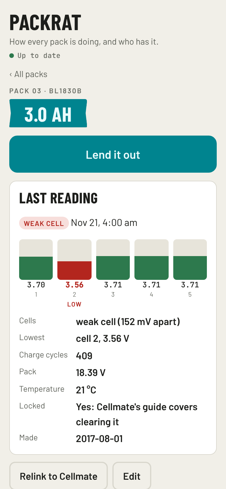
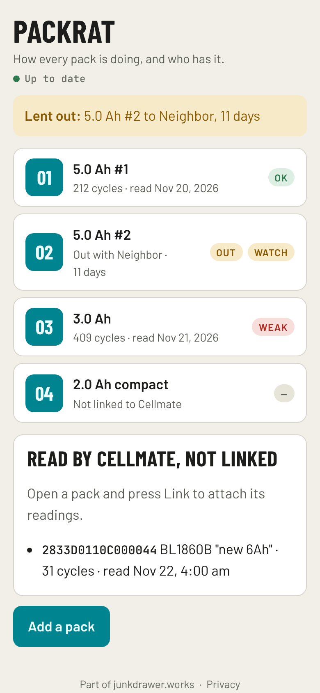

# Packrat

**Use it: [packrat.junkdrawer.works](https://packrat.junkdrawer.works/)** (writing stickers needs Chrome on an Android phone)

**A sticker on every Makita pack: tap it for the pack's cell balance and charge cycles over time, and who has it when it's lent out.** Readings come from Cellmate, an ESP32 battery reader that sends each one to the ledger. Packrat matches them to packs by the ROM id inside each battery, so every pack builds a history.

<p align="center">
  
  
</p>

## How it works

- **Health.** The spread between the five cells: up to 50 mV is balanced, 50 to 100 mV says watch it, over 100 mV means a weak cell (Cellmate's own lines, so a pack reads the same on both). A cell under 2.5 V reads **discharged**, and one over 4.25 V **cell too high**, in red whatever the spread: those are Cellmate's own limits, where it calls a pack bad, and Packrat never calls a pack better than Cellmate did.
- **Lending.** One tap to lend, one to mark it back, with who had it and when. The home page says how long each loan has been out, and once one has been out a month, since when; a lent pack still shows if its last reading says watch it or weak.
- **Linking.** A new pack is matched to Cellmate's readings once; after that every reading lands on it. Relink offers every battery Cellmate has read, so one linked to the wrong pack moves to the right one (two packs read before linking can take each other's readings), and a pack can be unlinked.
- **Switchboard.** Records live in your Switchboard ledger (a Google Sheet you own), so they follow you between the phone and the laptop. Connect from [tag.junkdrawer.works](https://tag.junkdrawer.works/).

## Running it

It's a static site: plain HTML, CSS and JavaScript, with no build step.

```sh
npx http-server -p 8080 -c-1 .   # then open http://localhost:8080 (add ?demo for sample data)
npm test                         # unit tests, then the page in Chromium with a pretend NFC reader
node tools/make-icons.mjs        # PNG icons from icon.svg
```

GitHub Pages serves it from `main`, `/ (root)`, at its own address (`CNAME`).

### Files

- `js/app.js`: the app.
- `js/packs.js`: readings, health and loans, unit-tested.
- `js/sample.js`: the made-up packs, Cellmate readings and loans for the sample (`?demo`).
- `js/attention.js`: what Switchboard's front page says about Packrat (Needs a look, Find anything, Check a tag's names), from packs.js's own rules. Switchboard imports it from this address, so keep its exports (COLLS, look, things, tags) and `test/attention.test.mjs` passing; it stays out of `sw.js` on purpose.
- `js/kit/`, `css/kit.css`: the tag apps' shared kit (ledger client, Web NFC, small UI helpers).
- `fonts/`: Barlow, Barlow Condensed and JetBrains Mono (SIL Open Font License), served from here so nothing loads from elsewhere.
- `test/e2e.mjs`, `test/app-checks.mjs`: the page in Chromium, offline included.

